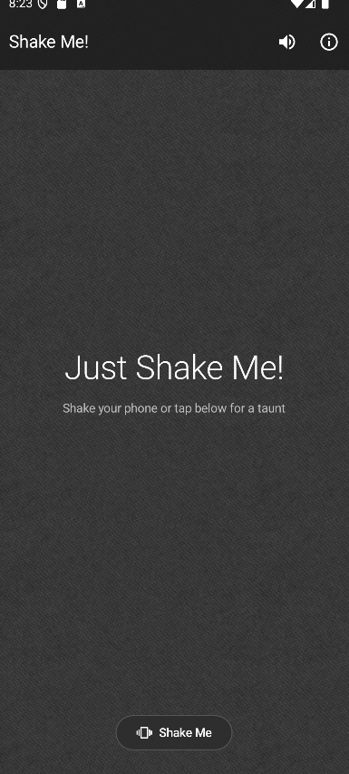
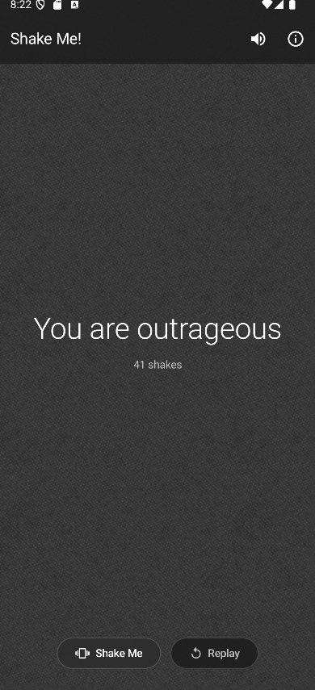

# ShakeTaunter

## Introduction

ShakeTaunter (**Shake Me!**) is a lighthearted native Android app that speaks playful taunts aloud whenever you shake your phone.

## Overview & Features

Built in Kotlin and Jetpack Compose over the classic dark iron-grip textured backdrop, ShakeTaunter turns a quick flick of your wrist into an instant spoken quip. Shaking your device triggers a custom accelerometer burst detector that picks from 80 playful taunts without repeating the previous line back-to-back, displays it with a subtle shake animation and haptic feedback, and reads it aloud using Android's on-device Text-to-Speech engine. Everything runs locally on your phone with zero ads and no cloud dependencies.

- **Accelerometer Shake Detection:** Dual-impulse threshold and cooldown filtering (`ShakeThresholdEvaluator`) with lifecycle-aware sensor registration that unregisters when paused.
- **80 Playful Taunts:** Preserves all 45 classic Shake Me! phrases alongside 35 new quips, avoiding consecutive repeats.
- **On-Device Text-to-Speech:** Speaks each taunt aloud with a toolbar mute/unmute toggle and an on-screen **Replay** button.
- **Tap-to-Taunt Accessibility:** Includes an on-screen **Shake Me** button so the app remains usable via touch or on devices without an accelerometer.
- **Modern Native Android UI:** Edge-to-edge Jetpack Compose interface with dark monochrome styling over the original `irongrip` weave texture.
- **Offline & Ad-Free:** Completely self-contained on-device with no analytics, ads, or network calls.

## Screenshots

| Main Screen | Sample Taunt Screen |
| :---: | :---: |
|  |  |

## Credits

- **Author:** Mohammad Hafiz bin Ismail ([mypapit@gmail.com](mailto:mypapit@gmail.com)) — [GitHub](https://github.com/mypapit/)
- **Copyright:** Copyright © 2018-2026 Mohammad Hafiz bin Ismail
- **License:** [2-Clause BSD License](https://opensource.org/licenses/BSD-2-Clause)
- **Google Play:** [Download from Google Play](https://play.google.com/store/apps/details?id=shaketaunt.mobile.mypapit.net.shaketaunt)
